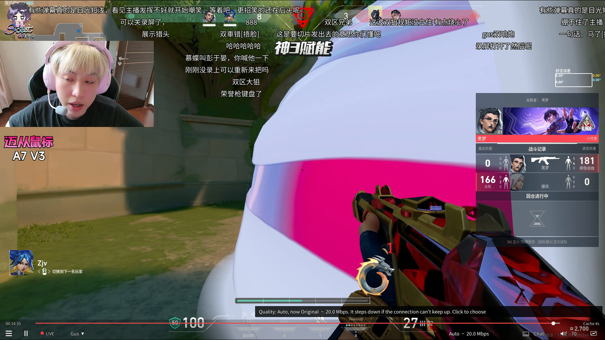
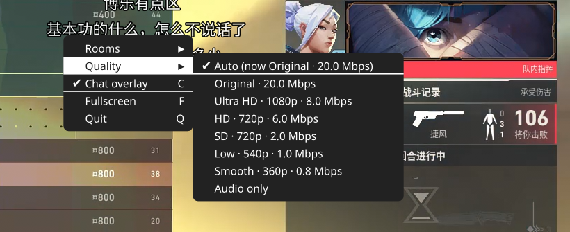

# cn-live-viewer

Watch [Huya](https://www.huya.com) and [Douyin](https://live.douyin.com) live rooms in [mpv](https://mpv.io):
- no ads;
- the highest bitrate the room offers;
- live chat scrolling over the video;
- switch rooms without leaving the player.

```
cn-live-viewer 333003
cn-live-viewer https://live.douyin.com/286658238204
```



## Features

- **Huya at 20 Mbps.** That's the web player's top option, which other tools don't list. Douyin plays the
  streamer's original upload.
- **Chat over the video**, scrolling right to left in the top half of the picture, and in the terminal.
- **Room list inside the player.** Press Tab, pick a room, and video and chat switch in the same window. Add, save,
  rename and remove rooms, and set the default room, from the same menu; new rooms are named after the streamer.
- **Reconnects** by itself when a stream drops.
- **Smooth on high-refresh monitors:** 60 fps streams are resampled to the display, so motion doesn't judder at
  144/160/240 Hz.
- **No login and no browser.** Only the public endpoints the sites' own web players use.

## Requirements

| | |
|---|---|
| OS | Linux, macOS or Windows. It's developed on Linux. On macOS and Windows, automated tests check that it installs, starts mpv and loads its scripts, but nobody has watched a stream there yet. |
| Python | 3.10 or newer |
| mpv | 0.39 or newer for the room list. Older versions play and show chat but have no room list. |
| Font | A Simplified Chinese font for the chat: Noto Sans CJK SC on Linux. macOS (PingFang SC) and Windows (Microsoft YaHei) have one built in. |

The install command below installs these for you. To install them yourself instead:

| System | Command |
|---|---|
| Debian, Ubuntu | `sudo apt install mpv pipx fonts-noto-cjk` |
| Fedora | `sudo dnf install mpv pipx google-noto-sans-cjk-fonts` (mpv comes from RPM Fusion) |
| Arch | `sudo pacman -S mpv python-pipx noto-fonts-cjk` |
| macOS | `brew install mpv pipx` |
| Windows | Python from [python.org](https://www.python.org/downloads/), and mpv from [mpv.io](https://mpv.io/installation/), e.g. `scoop install extras/mpv` |

## Install

One command. It installs what your system is missing (mpv, a Chinese font for the chat, Python 3.10+), asking before
it does, then cn-live-viewer itself, and adds **CN Live Viewer** to your apps.

Linux and macOS:

```bash
curl -fsSL https://raw.githubusercontent.com/jody0731/cn-live-viewer/main/install.sh | sh
```

Windows, in PowerShell:

```powershell
irm https://raw.githubusercontent.com/jody0731/cn-live-viewer/main/install.ps1 | iex
```

What they use:
- **System packages:** apt, dnf, pacman or zypper on Linux, Homebrew on macOS, winget on Windows.
- **No questions:** from a clone, `./install.sh --yes` or `install.ps1 -Yes` installs without asking.
- **cn-live-viewer itself:** pipx when you have it, otherwise a private Python environment. Git isn't needed.

With pipx and mpv already installed, this works too: `pipx install git+https://github.com/jody0731/cn-live-viewer`.

To update, run the install command again (or `pipx upgrade cn-live-viewer`).

### The app

**CN Live Viewer** comes with mpv's icon, added on install or on the first start:

| System | Where it is |
|---|---|
| Linux | The app menu and search. Pin it to a panel or dock. A Huya or Douyin link dropped on it opens that room. |
| macOS | `~/Applications`, so it's in Launchpad and Spotlight |
| Windows | The Start menu. It runs without a console window. |

Started from there, chat shows only on the video, as there is no terminal. `cn-live-viewer desktop remove` removes
it for good, and `cn-live-viewer desktop` adds it back.

## Use

| Command | What it does |
|---|---|
| `cn-live-viewer [ROOM]` | Watch a room. With no room, the first saved room plays. |
| `cn-live-viewer chat ROOM` | Print a room's chat in the terminal only |
| `cn-live-viewer url ROOM` | Print the stream address, for another player |
| `cn-live-viewer rooms` | List the saved rooms and show where the list is |
| `cn-live-viewer desktop [remove]` | Add (or remove) the app launcher |

ROOM is a room number or a link. A bare number is a Huya room unless it's saved as a Douyin room.

Options:

| Option | Meaning |
|---|---|
| `-q`, `--quality` | `auto` (default), a bitrate cap in Mbps such as `8`, or for Douyin `origin`, `hd`, `sd`, `ld` or `md`. See Quality. |
| `--no-overlay` | No chat over the video. It still prints in the terminal. |
| `--mpv-args="..."` | Extra mpv options, e.g. `--mpv-args="--volume=50 --fs"` |
| `--rooms FILE` | Use another room list |
| `-v` | Log connection details |

Keys in the player:

| Key | Action |
|---|---|
| Tab | Room list. Enter switches; typing searches the list. The entries after the rooms add, save, rename and remove rooms and set the default room. |
| C | Chat overlay on/off |
| Space | Pause |
| F | Fullscreen |
| Q | Quit |

All of mpv's usual keys work too.

With the mouse:
- **Control bar:** moving the mouse shows a slim bar at the bottom, in place of mpv's own. It hides 0.5 s after
  the mouse stops. Hover anything to see what it does.
  - **Seek row:** the playback time, a strip over the part of the stream mpv has buffered, and how many seconds are
    buffered ahead (Cache). On the strip, red is played and light grey is received but not yet played. Click or
    drag to go back; the right end is live.
  - **Left:** mpv's menu ☰ (key bindings, stream info, statistics, help), play/pause, and the LIVE badge. When
    you're behind, the badge shows how far (e.g. −0:42); click it to catch up. Then the room name: click it for the
    room list.
  - **Right:** the quality (e.g. "Auto · 20 Mbps"; click to choose), the chat overlay, volume (click to mute,
    scroll to change) and fullscreen.
- **Right-click menu:** Rooms (click one to switch), Quality, Chat overlay, Fullscreen and Quit. Right-click never pauses in
  cn-live-viewer's window.

  

## The room list

`~/.config/cn-live-viewer/rooms.conf` (Windows: `%APPDATA%\cn-live-viewer\rooms.conf`), created on the first
run. `cn-live-viewer rooms` shows where it is. One room per line:

```
# platform  room            name
huya        333003          A Huya room
douyin      286658238204    A Douyin room
```

- The first line is the default room, played when cn-live-viewer starts without a room. Change it in the player (Tab,
  Set the default room).
- On start, if the default room is offline, cn-live-viewer tries the rooms you watched lately, newest first,
  then the rest of the list, and plays the first one that's live.
- The room lists start each room with its status: ● Live, ○ Offline, ▶ Playing (or ▶ Waiting).
  - **Checks:** all saved rooms at once when cn-live-viewer starts, every 5 minutes, and when you open a room list,
    reusing results under 2 minutes old. Each check is one small request per room: a few MB an hour for a handful
    of rooms, against about 9 GB an hour of video.
  - **Open lists:** a list that is already open doesn't update until you open it again.
- **Offline rooms:** you can switch to one. Its chat runs, and the video starts by itself when it goes live
  (checked every 30 s).
- **Added rooms:** a room you add is switched to straight away, or waited for if it's offline.
- The name is free text.
- The room is the number in the room's address.
- Rooms you add or save in the player are named after the streamer. Rename them in the player (Tab, Rename a room)
  or in the file.

## Quality and data use

**Auto (the default)** starts at the best quality the room offers:
- **Step down:** if the buffer runs dry for more than 4 s, or twice within a minute, Auto steps down one level.
- **Step up:** after 5 calm minutes, it tries one level up.
- **Backing off:** if that try stalls too, it waits 20 minutes before trying again.
- **Notices:** every change shows on screen.

To fix a level, use the quality button in the control bar or right-click, then Quality. A fixed level carries over
to other rooms as a bitrate cap: "8 Mbps" picks the best level at or below 8 Mbps.

| Site | Levels |
|---|---|
| Huya | 20 Mbps, plus the room's own bitrates, usually 8, 4, 2 and 0.5 Mbps |
| Douyin | Original, HD, SD, Low and Smooth, with resolution and bitrate when the room gives them. Also Audio only, a manual choice that Auto never picks. |

At 20 Mbps, Huya uses about **9 GB per hour**. On a metered connection, cap it from the start:

```bash
cn-live-viewer 333003 -q 4
```

Douyin's original upload measured about 5 Mbps in testing, but it depends on the streamer.

## Settings

cn-live-viewer starts its own mpv with these options:

```
--profile=high-quality --hwdec=auto-safe --video-sync=display-resample --interpolation --tscale=oversample --window-maximized=yes
--demuxer-max-back-bytes=512MiB
```

The last one keeps up to 512 MiB of watched video in memory, so you can go back about 3.5 minutes at 20 Mbps (longer
at lower bitrates). The memory is only used as it fills; lower it with e.g. `--mpv-args="--demuxer-max-back-bytes=128MiB"`.
cn-live-viewer also turns off mpv's own control bar (`--osc=no`) and draws its own. These options are passed on the command
line, so they win over the same options in your `mpv.conf`. Everything else in
your `mpv.conf` and `input.conf` still applies. Change them with `--mpv-args`, which comes last, for example:

```bash
cn-live-viewer --mpv-args="--no-interpolation --window-maximized=no"
```

The chat overlay has three options:

| Option | Default | Meaning |
|---|---|---|
| `font` | depends on the OS | Font for the chat |
| `max_on_screen` | 60 | Most messages shown at once. Extra messages are skipped. |
| `max_fps` | 240 | Most redraws per second. Text moves on every display refresh up to this rate. |

Set them through `--script-opts`, prefixed with `cnlv-danmaku-`:

```bash
cn-live-viewer --mpv-args="--script-opts=cnlv-danmaku-max_on_screen=30,cnlv-danmaku-font='Noto Sans CJK SC'"
```

[`examples/`](examples) has a sample room list and optional `mpv.conf` and `input.conf` additions.

## Troubleshooting

- **"offline or not found":** the room isn't live, or the number is wrong. Try the room's full link.
- **No chat:**
  - run with `-v` to see the connection log;
  - chat and Douyin's room lookups connect directly and ignore proxy settings;
  - the video goes through mpv, which has its own `--http-proxy` option.
- **Video stutters when chat is busy:**
  - lower `max_on_screen`, or `max_fps` (moving text then looks less sharp);
  - or try `--mpv-args="--no-interpolation"`;
  - C turns the overlay off to check whether it's the cause.
- **Chat shows boxes instead of characters:** install a Simplified Chinese font (see Requirements).
- **mpv isn't found:** install it with your system's package manager.

## How it works

- **Huya:**
  - Streamlink finds the stream address, and cn-live-viewer raises its bitrate;
  - chat comes from Huya's websocket, in Tencent's TARS encoding.
- **Douyin:**
  - stream and chat come from the web player's endpoints, with only the visitor cookie;
  - chat is polled.
- **The player:**
  - one mpv window, controlled through its IPC socket;
  - two small Lua scripts draw the chat and the room list.

The details are in [docs/PROTOCOLS.md](docs/PROTOCOLS.md). [docs/DEVLOG.md](docs/DEVLOG.md) records what was tried
and measured.

## Disclaimer

An unofficial tool, not affiliated with Huya or Douyin. It uses the same public endpoints the sites' web players
use, and the sites can change them at any time. It only plays streams anyone can open in a browser without signing
in.

## License

[MIT](LICENSE)
